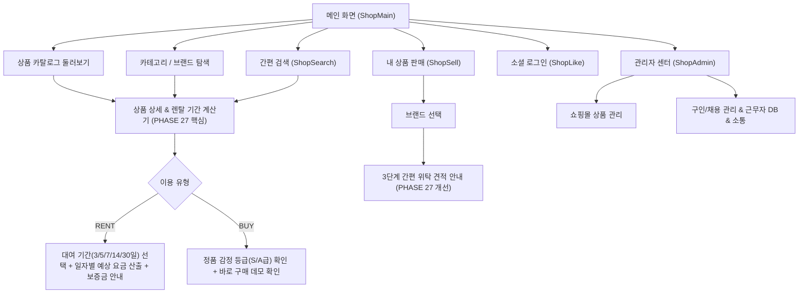

# luxuryRental — PHASE 25 UI/UX 정밀 진단 보고서 (UX_AUDIT.md)

## 1. 개요 및 진단 목표
본 보고서는 luxuryRental 서비스의 기존 브랜드 정체성(화이트 모바일 셸, 파스텔 렌트·구매·판매 카드, 블랙 로그인 CTA, 다크 글래스모피즘 관리자)과 콘텐츠를 100% 보존하면서, 실제 상용 명품 커머스 플랫폼 수준의 시각적 완성도와 사용성을 확보하기 위한 정밀 진단 결과입니다.

- **진단 일시**: 2026-10-30
- **진단 대상**: 
  - 고객용 스토어프론트: `ShopMain.tsx`, `ProductCatalog.tsx`, `ShopCategory.tsx`, `ShopSearch.tsx`, `ShopSell.tsx`, `ShopLike.tsx`, `BottomNav.tsx`
  - 관리자 시스템: `ShopAdmin.tsx`, `RecruitApp.tsx`, `AppContext.tsx`, `index.css`
- **평가 기준**: Nielsen Norman Group 10대 사용성 휴리스틱, 모바일 퍼스트 인터랙션 원칙, WCAG 2.2 접근성 지침, 커머스 구매/대여 전환 퍼널 원칙

---

## 2. 디자인 공통 규칙 및 정체성 분석 (Design Tokens & Systems)

### 2.1 기존 보존 대상 요소
1. **고객용 모바일 UI (Shop Shell)**:
   - 너비: `max-w-md` (375px~430px 기준 모바일 뷰포트 최적화, PC에서는 중앙 정렬 카드 셸 및 좌측 QR 배너 유지)
   - 헤더: `LUXURYRENTAL` 볼드 로고, 검색·장바구니·관리자 바로가기 아이콘
   - 시그니처 3대 카드: 
     - 👗 렌트하기 (핑크 파스텔: `bg-pink-50/70 border-pink-100/80 text-pink-600`)
     - 👜 구매하기 (블루 파스텔: `bg-blue-50/70 border-blue-100/80 text-blue-600`)
     - 🤝 판매하기 (그린 파스텔: `bg-green-50/70 border-green-100/80 text-green-700`)
   - 메인 CTA: 블랙 풀와이드 버튼 (`bg-gray-900 hover:bg-black text-white`)
   - 하단 5개 내비게이션 바: 카테고리, 내 상품 판매, 홈, 좋아요, 마이페이지 플로팅 필(Pill) 구조

2. **관리자 시스템 (Admin Center)**:
   - 테마: 슬레이트/아연 다크 그라데이션 (`from-slate-900 via-zinc-900 to-black`)
   - 컴포넌트: 글래스모피즘 (`backdrop-blur-md bg-white/5 border-white/10`)
   - 듀얼 모드: 쇼핑몰 관리(상품 등록/관리) & 구인/채용 관리(대시보드, 요청작성, 근무자DB, 실시간 소통)

### 2.2 개선 대상 공통 디자인 규칙
- **카드 인터랙션 피드백**: 모바일 터치 시 `active:scale-[0.98]` 적용 및 부드러운 트랜지션 보강
- **타이포그래피 위계**: 브랜드명(11px Bold) - 상품명(13px Semi-bold, 2줄 말줄임) - 가격(15px Extra-Bold tabular-nums) - 부가정보(11px Gray) 간 대비 강화
- **상태 태그 디자인**: RENT(핑크/퍼플 계열 포인트) vs BUY(다크 슬레이트 계열)의 시각적 구분감 명확화
- **데모 안내 표시**: 밋밋한 텍스트에서 신뢰감 있는 캡슐형 뱃지 및 인라인 정보 블록으로 정돈

---

## 3. 사용자 동선(User Journey) 정밀 분석

### 3.1 발견된 주요 동선 단절 문제
1. **상품 상세 경험 부재**: 상품 카드를 눌러도 아무런 반응이 없거나 로그인 창만 떠서, 사용자가 렌탈 조건(대여일수별 가격, 반납 프로세스, 보증금 정책)을 전혀 확인할 수 없음.
2. **판매하기 동선 종료**: 브랜드 검색 후 클릭 시 토스트 메시지만 노출되고 위탁 단계가 진행되지 않음.
3. **관리자 작업 피드백 단조로움**: 근무자 일괄 요청 시 몇 명이 선택되었는지에 대한 컨텍스트 뱃지가 미흡함.

---

## 4. Nielsen Norman Group 사용성 원칙 기반 평가

| NN/g 원칙 | 현재 평가 | 진단 내용 및 개선 방향 |
|---|:---:|---|
| **1. 시스템 상태의 가시성** | 보통 (P2) | 상품 로딩/에러 상태는 구현되어 있으나, 렌탈 기간 선택에 따른 총 예상 비용 피드백 부재. |
| **2. 실세계와 시스템의 일치** | 우수 | 명품 렌탈/구매/판매 용어 및 원화(KRW) 표기법 준수. |
| **3. 사용자 제어 및 자유도** | 우수 | ESC 키 닫기, 뒤로가기 버튼, 포커스 트랩이 안정적으로 작동함. |
| **4. 일관성 및 표준** | 보통 (P2) | 버튼의 패딩, 폰트 굵기, 카드 코너 라운딩(`rounded-xl` vs `rounded-2xl`)이 혼용됨. |
| **5. 오류 예방** | 양호 (P2) | 구인 요청 폼에서 날짜/인원 유효성 검사가 있으나 인라인 에러 텍스트 표기 미비. |
| **6. 기억보다는 인식** | 미흡 (P1) | 검색 시 이전 검색어 기록(Recent Searches)이 없어 반복 입력 필요. |
| **7. 유연성 및 사용 효율성** | 양호 | 카테고리 LNB와 서브카테고리, 브랜드 가로 스크롤 탭 제공. |
| **8. 미적이고 단순한 디자인** | 양호 (P2) | 불필요한 장식은 적으나 카드 간 마진 및 텍스트 행간 미세 조정 필요. |
| **9. 오류 인식, 진단, 복구** | 보통 (P2) | 검색 결과 0건 시 쿼리 초기화 및 추천 검색어 재시도 원터치 버튼 보강 필요. |
| **10. 도움말 및 문서화** | 양호 | 가이드 한눈에 섹션과 서비스 토스트 안내 제공 중. |

---

## 5. 결론 및 고도화 방향
luxuryRental의 기존 브랜드 디자인 자산은 매우 훌륭합니다. 전면적인 리디자인을 피하고, 사용자가 직접 상호작용할 수 있는 **상품 상세 & 렌탈 계산기 모달(Phase 27)**, **더 세련되고 입체감 있는 카드 및 헤더 마이크로 인터랙션(Phase 26)**, **작업 편의성이 극대화된 관리자 폼 및 뱃지 시스템(Phase 28)**으로 서비스 완성도를 결정적으로 끌어올리겠습니다.
