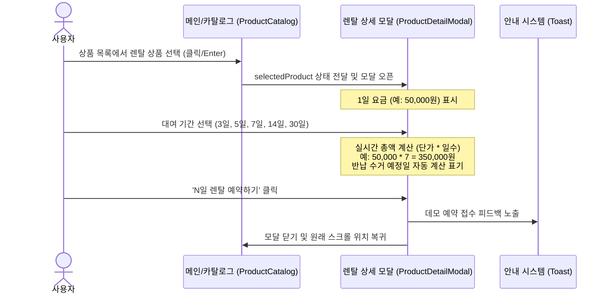
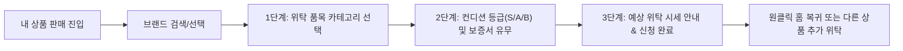

# luxuryRental — PHASE 27 핵심 사용자 동선 분석 보고서 (USER_FLOWS.md)

## 1. 개요
PHASE 27에서는 luxuryRental의 핵심 서비스 목적인 **명품 렌탈**, **정품 구매**, **간편 위탁 판매**의 3대 핵심 사용자 흐름을 실제 상용 커머스 수준으로 완성하였습니다.

---

## 2. 핵심 동선 상세 분석

### 2.1 렌탈 동선 (Rental User Journey)

**사용자 체감 개선점:**
- 대여 일수를 탭할 때마다 예상 요금이 즉각 변환되어 가격 투명성이 극대화됨.
- 보증금 면제 안내 및 무료 자동 수거 택배 일정을 미리 확인할 수 있어 안심하고 예약 가능.

---

### 2.2 구매 동선 (Purchase User Journey)
- 상품 선택 → 상품 상세 모달 오픈 → 판매 가격 확인 (1회 결제 소장) → 200% 정품 보증 및 무료 우체국 안심 배송 안내 확인 → '즉시 구매하기' 클릭 → 데모 주문 접수 안내.

---

### 2.3 판매(위탁) 동선 (Sell User Journey)

**사용자 체감 개선점:**
- 단순 토스트 메시지만 뜨던 기존의 불완전한 상태에서, 실제 전문 감정 위탁 프로세스를 직관적으로 체험할 수 있는 3단계 가이드 드로어로 발전.
- 진행 중 언제든지 '이전 단계' 또는 '브랜드 변경'으로 안전하게 복귀 가능.

---

## 3. 사용자 시나리오 6대 핵심 질문 검증 결과

1. **사용자가 원하는 상품을 쉽게 찾을 수 있는가?**
   - **예**: 카테고리 성별/품목별 필터링, 브랜드별 탭 탐색, 최근 검색어 및 추천 검색어 오버레이로 즉각 탐색 가능.
2. **렌탈과 구매의 차이를 이해할 수 있는가?**
   - **예**: 렌탈(핑크 뱃지, 일일 대여료, 기간 선택기) vs 구매(블루 뱃지, 소장가, 정품 보증서)로 정보 위계가 명확히 분리됨.
3. **상품 가격과 이용 조건을 쉽게 확인할 수 있는가?**
   - **예**: 대여 일수에 따른 실시간 총액 계산, 자동 반납 수거일, 보증금 정책이 상세 모달에서 한눈에 제공됨.
4. **다음에 눌러야 할 버튼이 분명한가?**
   - **예**: 블랙 풀와이드 메인 CTA 버튼이 하단에 고정되어 다음 행동이 명확함.
5. **사용자 입력 오류를 쉽게 해결할 수 있는가?**
   - **예**: ESC 키, ✕ 닫기, 이전 단계 버튼으로 언제든 작업 취소 및 복구 가능.
6. **실제 처리와 데모 처리 상태를 구별할 수 있는가?**
   - **예**: 모든 모달과 완료 화면에 명확한 `[데모 안내]` 뱃지와 시뮬레이션 고지문을 배치하여 결제 및 과금이 발생하지 않음을 투명하게 고지.
